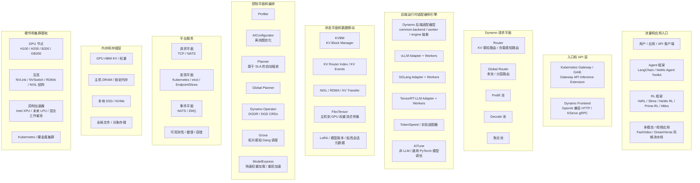
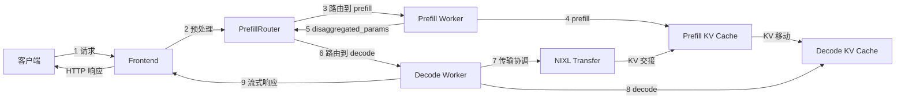

# NVIDIA Dynamo：全景架构

[`Dynamo`](https://github.com/ai-dynamo/dynamo) 最好理解为一个位于模型引擎之上的分布式推理编排层，而非另一个独立的引擎。它协调跨大型 GPU 集群的请求路由、KV 感知状态管理、自动缩放、部署和数据移动。

本页面呈现 Dynamo 生态系统的自上而下全景，从流量入口开始，到存储层和硬件结束。

## 自上而下全景

## 端到端请求流程

官方 [dynamo-flow.md](https://github.com/ai-dynamo/dynamo/blob/main/docs/design-docs/dynamo-flow.md) 增加了全景图本身未展示的动态视图：单个分离式请求如何在系统中移动。

### 9 步请求生命周期

1. **请求**：客户端向 Dynamo Frontend 发送 HTTP 请求
2. **预处理**：Frontend 验证、模板化和分词输入
3. **路由到 prefill**：PrefillRouter 使用 KV 感知路由或负载均衡选择 prefill worker
4. **Prefill**：prefill worker 计算提示 KV 状态
5. **返回元数据**：prefill worker 发回包含传输元数据的 `disaggregated_params`
6. **路由到 decode**：路由器将 prefill 结果注入 decode 请求并选择 decode worker
7. **KV 传输**：decode worker 协调从 prefill 端的直接 KV 移动，通常通过 NIXL
8. **Decode**：decode worker 使用传输的 KV 缓存生成输出 token
9. **响应**：token 通过 Frontend 流式返回给客户端

### 流程图

### 流程如何映射到全景图

| 流程阶段 | 全景图层 | 重要性 |
| --- | --- | --- |
| 请求 + 预处理 | 入口和 API 层 | Frontend 是 OpenAI 兼容流量的归一化点 |
| Prefill 和 decode 路由 | Dynamo 请求平面 | Router 和 Global Router 决定工作器放置和池选择 |
| KV 交接 | 状态平面和数据移动 | KVBM、KV 元数据和 NIXL 保持重用局部性并减少重新计算 |
| Token 生成 | 后端运行时适配器和引擎 | vLLM、SGLang 或 TRT-LLM 执行实际前向传递 |
| 发现、指标、自动缩放 | 平台服务和控平面 | 工作器注册、规划器指标和缩放与请求路径并行运行 |

## 如何阅读图表

| 层 | 负责内容 | 主要项目或组件 |
| --- | --- | --- |
| 流量入口 | 用户流量和上层框架 | 应用、Agent 框架、RL 推出框架 |
| 入口 | API 归一化和集群入口 | Gateway API Inference Extension、Dynamo Frontend |
| 请求平面 | 请求路由和工作器选择 | Router、Global Router、prefill 池、decode 池 |
| 引擎层 | 针对具体模型运行时的执行 | vLLM、SGLang、TensorRT-LLM、实验适配器 |
| 状态平面 | KV 生命周期、重用和传输 | KVBM、KV events、NIXL、粘性会话元数据 |
| 控制平面 | 性能分析、规划、部署和缩放 | Profiler、AIConfigurator、Planner、Operator、Grove |
| 平台服务 | 传输、发现、可观测性 | TCP/NATS 请求平面、Kubernetes 或 etcd 发现、NATS/ZMQ 事件平面 |
| 存储层 | KV 和权重的内存层次 | HBM、主机 DRAM、本地 SSD、对象或文件存储 |
| 硬件 | 物理执行基础 | GPU 节点、NVLink、RDMA 结构、异构加速器 |

## KVBM：Dynamo 状态平面的中心

官方 [KVBM 设计文档](https://github.com/ai-dynamo/dynamo/blob/main/docs/design-docs/kvbm-design.md)明确指出 KVBM 不仅仅是一个缓存容器。它是跟踪块生命周期、内存层放置和跨节点移动的状态平面编排层。

### KVBM 分层模型

| 层 | 角色 | 存储内容 |
| --- | --- | --- |
| G1 | 设备池 | GPU 常驻的 HBM KV 块 |
| G2 | 主机池 | 用于卸载和回叫的 CPU 锁定内存 KV 块 |
| G3 | 磁盘池 | 本地 SSD 或 NVMe 支持的 KV 块 |
| G4 | 远程存储 | 通过 NIXL 访问的共享对象或文件存储 |

### KVBM 核心机制

- **KvBlockManager / KvBlockManagerState** 拥有块池、布局配置、指标和事件钩子
- **TransferManager** 协调跨路径（如 Device→Host、Host→Disk、Host→Device、Disk→Device）的异步移动
- **块生命周期**遵循从 `Reset` 到 `Partial`、`Complete` 和 `Registered` 的状态机，这是通过 `sequence_hash` 实现去重和安全重用的关键
- **基于 RAII 的发布/移除句柄**将块注册和移除推入事件平面，使其他组件可以保持可重用 KV 状态的一致视图

### NIXL 在此的重要性

KVBM 使用 NIXL 不仅仅作为传输机制，而是使远程 KV 可见性和传输可移植的机制：

- 它注册远程访问的内存区域
- 它序列化布局元数据，使具有不同 TP 布局的工作器仍能就块几何达成一致
- 它支持主机和磁盘接入流程，包括远程存储访问

## 发现平面：组件如何找到工作器

官方 [discovery-plane.svg](https://github.com/ai-dynamo/dynamo/blob/main/docs/assets/img/discovery-plane.svg) 显示了一个简单但重要的分离：

- **组件**（如 Frontend、Router、Planner）需要**发现**
- **工作器**需要**注册**
- 实际的发现后端是 **Kubernetes 原生**或 **etcd**

### 发现后端

| 后端 | 机制 | 运维含义 |
| --- | --- | --- |
| Kubernetes | `DynamoWorkerMetadata` CRDs + `EndpointSlices` + API watch | 一级 K8s 原生发现路径 |
| etcd | `/services/{namespace}/{component}/{endpoint}` + 租约清理 | 默认非 Kubernetes 发现后端 |

## 路线图背景：1.0 加固到 2.0 扩展

当前架构在将其与 Dynamo 团队 2026 年发布的两个路线图问题对齐时，读起来会有所不同。

### Issue #5506：H1 '26 路线图

Issue [#5506](https://github.com/ai-dynamo/dynamo/issues/5506) 创建于 **2026-01-20**，是从 pre-1.0 版本到 1.0 发布期的桥梁。它关注五个方面：

- 性能
- 生产级服务和缩放
- 核心路由器和 KV 缓存
- Agents
- 多模态和扩散

### Issue #9208：迈向 Dynamo 2.0

Issue [#9208](https://github.com/ai-dynamo/dynamo/issues/9208) 创建于 **2026-05-06**，将框架从"发布 1.0"转向"扩展系统边界"。声明的方向是覆盖除预训练外的几乎所有 GPU 使用场景。

## 周边项目及其角色

- **推理引擎**：Dynamo 编排引擎如 [vLLM](https://github.com/vllm-project/vllm)、[SGLang](https://github.com/sgl-project/sglang) 和 [TensorRT-LLM](https://github.com/NVIDIA/TensorRT-LLM)，而非取代它们
- **Kubernetes 编排**：[Grove](https://github.com/ai-dynamo/grove) 为多节点部署提供拓扑感知、Gang 调度的工作负载模型
- **配置和规划**：[AIConfigurator](https://github.com/ai-dynamo/aiconfigurator) 离线探索部署候选，Planner 和 Global Planner 在线应用缩放决策
- **模型启动和内存**：[ModelExpress](https://github.com/ai-dynamo/modelexpress) 减少模型启动延迟，[FlexTensor](https://github.com/ai-dynamo/flextensor) 通过流式传输主机和 GPU 内存之间的张量扩展模型适配
- **非 LLM 覆盖**：[AITune](https://github.com/ai-dynamo/aitune) 将 Dynamo 扩展到通用 PyTorch 推理，特别是针对定制非 LLM 模型

## 关键要点

- Dynamo 是分布式推理的**系统层**，而非模型引擎的独立替代品
- 其最独特的能力位于**请求平面**、围绕 KVBM 和 NIXL 的**状态平面**以及围绕 Planner、Operator 和 Grove 的**控制平面**
- 周边 `ai-dynamo` 项目在三个方向扩展 Dynamo：**规划**、**Kubernetes 编排**和**内存/权重移动**

## 参考资料

- [ai-dynamo/dynamo](https://github.com/ai-dynamo/dynamo)
- [Dynamo KVBM Design](https://github.com/ai-dynamo/dynamo/blob/main/docs/design-docs/kvbm-design.md)
- [Dynamo Discovery Plane SVG](https://github.com/ai-dynamo/dynamo/blob/main/docs/assets/img/discovery-plane.svg)
- [Dynamo Issue #5506: H1 '26 roadmap](https://github.com/ai-dynamo/dynamo/issues/5506)
- [Dynamo Issue #9208: Toward Dynamo 2.0](https://github.com/ai-dynamo/dynamo/issues/9208)
- [ai-dynamo/grove](https://github.com/ai-dynamo/grove)
- [ai-dynamo/aiconfigurator](https://github.com/ai-dynamo/aiconfigurator)
- [ai-dynamo/modelexpress](https://github.com/ai-dynamo/modelexpress)
- [ai-dynamo/aitune](https://github.com/ai-dynamo/aitune)
- [ai-dynamo/flextensor](https://github.com/ai-dynamo/flextensor)
