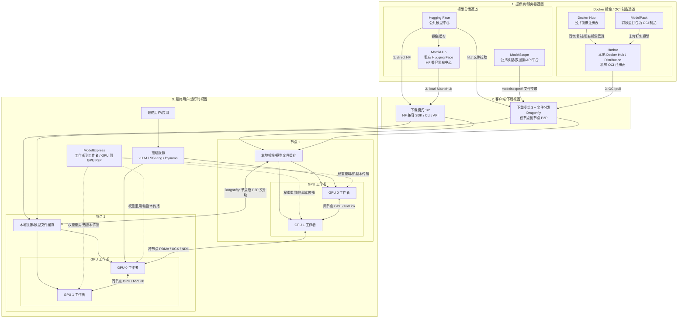
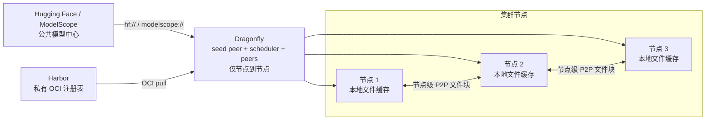
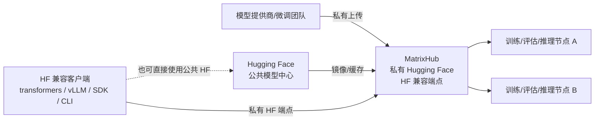
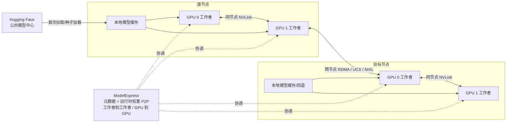

# 模型分发栈一图总览：Hugging Face、MatrixHub、Harbor、Dragonfly、ModelPack 和 ModelExpress

本页面将几个经常混淆的项目放在一张图上。目标是区分**模型源**、**私有注册表**、**集群分发**和**运行时加速**各层。

## 栈的一图总览

## 按角色阅读图表

- **提供商/服务器视图**：蓝色通道是 Docker 镜像 / OCI 制品路径。Harbor 可理解为本地 Docker Hub / Distribution 风格的私有注册表，ModelPack 是将模型转换为 OCI 制品的打包步骤。橙色通道是模型分发路径，包括 Hugging Face、ModelScope 和 MatrixHub。
- **下载视图**：在此框架中有三种下载模式：`1. 直接 Hugging Face`、`2. 本地 MatrixHub` 和 `3. 通过 OCI 适配从 Docker Hub / Harbor 进行的 OCI 拉取`。Dragonfly 位于文件分发层，仅处理节点级 P2P。
- **最终用户/运行时视图**：模型文件首先到达节点本地缓存，然后供给 GPU 工作者。ModelExpress 位于路径下游，加速工作者到工作者和 GPU 到 GPU 的权重重用，包括通过 RDMA 的跨节点传输。

线条颜色也有含义：

- **橙色链接**：HF 兼容或公共模型中心下载路径
- **蓝色链接**：OCI 拉取路径
- **灰色节点到节点链接**：Dragonfly 节点级文件块传播
- **绿色 GPU 到 GPU 链接**：与 ModelExpress 相关的运行时权重共享路径

一句话总结：

- **三种模型下载模式**：`1. direct HF`、`2. local MatrixHub`、`3. OCI-adapted Docker Hub / Harbor`
- **两种 P2P 分发模式**：`Dragonfly = 仅节点到节点`、`ModelExpress = 工作者到工作者 / GPU 到 GPU`

## 聚焦参考图

### 1. Dragonfly 路径：Harbor 加公共模型中心

### 2. MatrixHub 路径：私有 Hugging Face 风格访问

### 3. ModelExpress 路径：初始拉取后的运行时权重共享

## 从左到右阅读图表

### 1. Hugging Face

Hugging Face 是公共上游模型中心。它是使用 `huggingface_hub`、`transformers`、`vLLM` 等客户端进行许多训练和推理工作流的默认来源。

### 2. Private Hugging Face

Private Hugging Face 是一个**目标状态**，而非单一产品。它意味着：

- 私有模型托管
- 访问控制和治理
- 与现有 HF 风格工作流低摩擦兼容
- 企业或气隙环境中的可预测分发

### 3. MatrixHub

MatrixHub 是该栈中最直接的实现路径。它充当**HF 兼容的私有中心**，因此团队可以保留 Hugging Face 交互模式，同时迁移到受治理的内部端点。

在实践中，MatrixHub 是用于以下方面的层：

- 私有模型注册表和生命周期治理
- 透明 HF 代理行为
- 按需从公共 Hugging Face 缓存
- 多区域或气隙分发工作流

### 4. ModelPack + Harbor + Dragonfly

此路径不同。它是 **OCI 优先**，而非 HF 优先。

- `ModelPack` 提供基于 OCI 的模型制品的打包/规范路径
- `Harbor` 提供私有 OCI 注册表，包括企业治理功能，如 RBAC、签名、复制和保留
- `Dragonfly` 使用预热和 P2P 传输模式加速从注册表到节点的分发

### 5. ModelExpress

ModelExpress 位于路径下游。它不是主要模型中心。其主要任务是**集群内部的运行时权重移动和冷启动减少**。

通常这意味着：

- 协调推理集群中的缓存使用
- 减少重复的模型拉取和加载
- 实现工作者到工作者的传输
- 加速从存储或缓存到服务工作者的最后一公里

## 最常见的架构模式

### 模式 A：公共 Hugging Face

当便利性比控制更重要时使用。

`客户端 -> Hugging Face`

### 模式 B：使用 MatrixHub 的私有 Hugging Face

当现有 HF 工作流应几乎保持不变时使用。

`客户端 -> MatrixHub -> Hugging Face 或私有存储`

### 模式 C：使用 Harbor + ModelPack + Dragonfly 的私有模型注册表

当平台已以 OCI 制品和 Kubernetes 为中心时使用。

`构建/打包 -> ModelPack -> Harbor -> Dragonfly -> 集群节点`

### 模式 D：MatrixHub + ModelExpress

当您需要同时拥有**私有 Hugging Face 风格访问**和**更快速的集群运行时加载**时使用。

`客户端 -> MatrixHub -> 集群缓存/源 -> ModelExpress -> 工作者`

## 快速定位表

| 组件 | 主要层 | 最适合 |
| --- | --- | --- |
| Hugging Face | 公共上游中心 | 公共模型发现和默认客户端工作流 |
| Private Hugging Face | 能力/目标状态 | 内部 HF 类似体验 |
| MatrixHub | 私有模型中心 | HF 兼容的内部分发和治理 |
| ModelPack | 打包/规范 | 基于 OCI 的模型制品定义 |
| Harbor | 私有注册表 | OCI 制品治理和复制 |
| Dragonfly | 集群分发 | 大规模节点级拉取加速 |
| ModelExpress | 运行时加速 | 集群内冷启动和权重传输优化 |

## 实用经验法则

- 如果问题是**"模型应该存放在哪里以及如何治理？"**，考虑 `MatrixHub` 或 `Harbor`
- 如果问题是**"我们想要 HF 兼容的开发者体验还是 OCI 优先的制品工作流？"**，在 `MatrixHub` 和 `Harbor + ModelPack` 之间选择
- 如果问题是**"如何减少集群冷启动和重复的权重移动？"**，考虑 `Dragonfly` 和 `ModelExpress`
- 如果问题是**"如何在改善最后一公里运行时加载的同时保持 HF 类似访问？"**，结合 `MatrixHub` 和 `ModelExpress`

## 参考资料

- [MatrixHub](https://github.com/matrixhub-ai/matrixhub)
- [ModelExpress](https://github.com/ai-dynamo/modelexpress)
- [Harbor](https://goharbor.io/)
- [Dragonfly](https://d7y.io/)
- [ModelPack](https://modelpack.org/)
- [Hugging Face](https://huggingface.co/)
