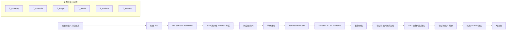

# GPU Pod 冷启动优化

本指南涵盖了在 Kubernetes 中最小化 GPU 加速 Pod 冷启动延迟的策略，特别是针对 AI/ML 推理工作负载。基于 KubeCon NA 2025 演示和云提供商的生产实现。

## 相关 2026 深度文章

- [GPU Pod 冷启动优化：AI 工作负载的性能突破](../blog/2026-04-06/2026-04-06-gpu-pod-cold-start-optimization_zh.md)

## 可编辑的 GPU Pod 启动流程（关键路径）

可编辑源文件：[gpu-pod-startup-critical-path.mmd](../../diagrams/gpu-pod-startup-critical-path.mmd)



## 为什么 GPU Pod 冷启动很重要

GPU Pod 冷启动指的是从 Pod 创建到加载好模型可服务推理请求的时间。对于 AI 工作负载，这包括：

- Pod 调度和创建
- 容器镜像拉取
- GPU 设备初始化
- 模型权重加载到 GPU 内存
- 模型编译和优化
- 缓存预热和就绪

**关键挑战：**

- 大模型体积（7B-70B+ 参数，10GB-100GB+ 权重）
- GPU 内存初始化开销
- 模型加载和编译时间
- 用户对低延迟的期望
- 冷启动期间 GPU 空闲的成本

**对生产的影响：**

- **Serverless AI**：冷启动阻塞请求处理
- **自动扩缩**：慢速冷启动降低扩缩有效性
- **多租户**：模型切换产生冷启动代价
- **成本效率**：冷启动期间空闲 GPU 浪费资源

## 典型 GPU Pod 冷启动时间

冷启动时间因模型大小和优化程度而异：

- **10-30 秒**：小模型（1B-7B 参数），优化加载
- **30-60 秒**：中等模型（7B-13B 参数），标准格式
- **1-3 分钟**：大模型（13B-70B 参数），PyTorch pickle
- **3-10 分钟**：超大模型（70B+ 参数），无优化

## 大规模下的瓶颈定位（超大集群 vs 多集群）

结合本指南与 `pod-startup-speed.md` 以及 KCD Beijing 2026（"超大集群还是多集群？"），冷启动瓶颈通常分布在控制面、调度、分发和网络上。

### 单一超大集群：常见的冷启动瓶颈

- **API server 和 etcd 压力**：事件风暴、激进的控制器或昂贵的准入路径可能延迟 Pod 创建和 watch 传播。
- **异构环境下的调度器积压**：混合 CPU/GPU SKU、拓扑约束和 gang 语义增加了调度等待时间。
- **镜像/模型分发争用**：大型镜像和模型制品争夺 registry/对象存储带宽。
- **DNS 和服务发现压力**：高 QPS 和短生命周期请求可能在冷启动窗口期间放大尾延迟。
- **Operator/控制面开销**：高频协调循环消耗共享控制面预算。

### 多集群：哪些改进了，哪些更难了

| 维度 | 超大集群 | 多集群 |
| --- | --- | --- |
| 爆炸半径 | 更大 | 每个集群更小 |
| 资源利用率 | 全局池化更容易 | 隔离性更好，碎片化风险更高 |
| 冷启动可预测性 | 受共享控制面负载影响 | 如果预留容量，每个租户/区域更稳定 |
| 网络规划 | 单一但复杂的扩展路径 | 跨集群连接/发现成为一等公民 |
| 运维 | 集中式 | 无自动化时管理开销更高 |

### 实用排查顺序

1. 验证控制面延迟（`Pod create -> watch visible`）。
2. 测量调度等待时间（`PodScheduled` 间隔）和 GPU 容量就绪状态。
3. 分离镜像拉取时间和模型获取/加载时间。
4. 独立测量运行时初始化和预热时间。
5. 验证突发启动下的 DNS/服务发现行为。

对于大规模预生产验证，在更改生产自动扩缩策略之前，使用 KWOK/Kubemark 等工具构建可重复测试。

## 三种主要解决方案

### 方案 1：预热的 GPU 池

预热维护了一个 GPU Pod 池，模型已加载到内存中，可以立即服务请求。

#### 架构

```text
┌─────────────────────────────────────────────────────────────┐
│                        负载均衡器                             │
└──────────────────────┬──────────────────────────────────────┘
                       │
                       ▼
┌─────────────────────────────────────────────────────────────┐
│                        请求队列                               │
└──────────────┬────────────────────┬─────────────────────────┘
               │                    │
               ▼                    ▼
┌──────────────────────┐  ┌──────────────────────┐
│   GPU 1（预热）       │  │   GPU 2（预热）       │
│   模型已加载          │  │   模型已加载          │
│   可服务              │  │   可服务              │
└──────────────────────┘  └──────────────────────┘
```

#### 关键特性

**预热过程：**

1. 初始化期间创建 GPU Pod 池
2. 将模型加载到 GPU 内存
3. 预热缓存和编译内核
4. 在负载均衡器中标记 Pod 为就绪
5. 将传入请求路由到预热池
6. 基于需求动态维护池大小

**优势：**

- **零冷启动延迟**：命中的预热池请求无延迟
- **可预测的性能**：一致的响应时间
- **即时可扩展性**：最高可达池大小
- **稳定工作负载下更好的资源利用率**

**权衡：**

- **成本开销**：即使空闲，GPU 仍然被分配
- **内存浪费**：模型无论是否使用都留在内存中
- **池大小调整**：池过小导致冷启动，过大浪费资金
- **多模型复杂性**：每个模型变体需要单独的池

#### 实现策略

**静态预热：**

```yaml
apiVersion: apps/v1
kind: Deployment
metadata:
  name: llm-inference-warm-pool
spec:
  replicas: 3  # 维持 3 个预热实例
  template:
    spec:
      containers:
      - name: vllm-server
        image: vllm/vllm-openai:latest
        command: ["python", "-m", "vllm.entrypoints.openai.api_server"]
        args:
        - --model=/models/llama-2-7b
        - --gpu-memory-utilization=0.95
        resources:
          limits:
            nvidia.com/gpu: 1
        readinessProbe:
          httpGet:
            path: /health
            port: 8000
          initialDelaySeconds: 60  # 为模型加载留时间
          periodSeconds: 10
```

**带 HPA 的动态预热：**

```yaml
apiVersion: autoscaling/v2
kind: HorizontalPodAutoscaler
metadata:
  name: llm-inference-hpa
spec:
  scaleTargetRef:
    apiVersion: apps/v1
    kind: Deployment
    name: llm-inference-warm-pool
  minReplicas: 2  # 最小预热池大小
  maxReplicas: 10
  metrics:
  - type: Resource
    resource:
      name: gpu-utilization
      target:
        type: Utilization
        averageUtilization: 70
  - type: Pods
    pods:
      metric:
        name: inference_queue_length
      target:
        type: AverageValue
        averageValue: "5"
```

**多模型池管理：**

为服务多个模型，实现智能池分配：

```yaml
# 模型 A：高流量，大池
apiVersion: apps/v1
kind: Deployment
metadata:
  name: model-a-warm-pool
spec:
  replicas: 5
  # ... model-a 配置

---
# 模型 B：中流量，中池
apiVersion: apps/v1
kind: Deployment
metadata:
  name: model-b-warm-pool
spec:
  replicas: 2
  # ... model-b 配置

---
# 模型 C：低流量，小池或 scale-to-one
apiVersion: apps/v1
kind: Deployment
metadata:
  name: model-c-warm-pool
spec:
  replicas: 1
  # ... model-c 配置
```

#### 生产实现

**GKE Agent Sandbox：**

Google Kubernetes Engine 的 Agent Sandbox 将预热池与 gVisor 快照相结合：

- **亚秒级延迟**：相比冷启动提升高达 90%
- **强隔离**：gVisor sandbox 保证每个实例的安全性
- **基于快照**：从快照恢复预热容器
- **生产就绪**：在 GKE 中可用于 agentic AI 工作负载

**配置示例：**

```yaml
apiVersion: v1
kind: Pod
metadata:
  name: agent-sandbox-pod
spec:
  runtimeClassName: gvisor  # 使用 gVisor 进行隔离
  containers:
  - name: agent-executor
    image: gcr.io/project/agent-runtime:latest
    resources:
      limits:
        nvidia.com/gpu: 1
```

**AWS Lambda GPU（预览版）：**

- 预热的 Lambda 实例，可访问 GPU
- 从零到数千实例的自动扩缩
- 仅按计算时间付费，不为空闲期付费

**Azure Container Instances with GPU：**

- 快速的 GPU 容器启动
- 预拉取镜像减少冷启动
- 无服务器 GPU 实例

#### 最佳实践

**池大小调整：**

- 监控队列长度和请求延迟
- 基于流量模式（日/周周期）合理调整池大小
- 维持最小池以确保响应能力
- 在流量峰值前主动扩容

**成本优化：**

- 对非关键池使用 spot/preemptible 实例
- 在低流量期间缩小池
- 尽可能实现跨请求的模型共享
- 监控每次推理的成本并优化池大小

**监控：**

```text
预热池关键指标：
- 池利用率百分比（目标：70-85%）
- 冷启动频率（命中非预热 Pod 的请求）
- 平均请求延迟（P50, P95, P99）
- 每个实例的 GPU 空闲时间
- 每次推理请求的成本
```

---

### 方案 2：更快的序列化

模型序列化格式对加载时间有显著影响。不同格式由于反序列化开销、内存复制和初始化要求而有不同的加载时间。

#### 序列化格式对比

基于加载 7B 参数 LLM 的生产基准测试：

| 格式 | 加载时间 | 速度评级 | 说明 |
|----------------|-----------|--------------|--------------------------|
| PyTorch pickle | 12s | 慢 | 传统格式，不安全 |
| TorchScript | 7s | 较好 | 针对推理优化 |
| Safetensors | 5s | 好 | 安全、快速、推荐 |
| ONNX | 4s | 最快 | 跨平台、优化 |

**相对性能：**

```text
PyTorch pickle：██████████████████████████ 12s（最慢）
TorchScript：   ██████████████████ 7s
Safetensors：   ████████████ 5s
ONNX：          ██████████ 4s（最快）
```

#### 格式特性

**PyTorch Pickle（.bin, .pt 文件）：**

- **加载时间**：7B 模型约 12 秒
- **安全性**：容易受到任意代码执行攻击
- **兼容性**：原生 PyTorch 格式
- **用例**：传统模型，仅开发环境

**缺点：**

- Python pickle 反序列化导致加载最慢
- 不可信模型文件存在安全风险
- 内存复制效率低下
- 不支持内存映射

**TorchScript（.pt, .pth 文件）：**

- **加载时间**：7B 模型约 7 秒
- **安全性**：比 pickle 安全，但仍依赖 PyTorch
- **兼容性**：PyTorch 推理优化
- **用例**：生产 PyTorch 部署

**优势：**

- 比 pickle 格式快 40%
- 针对推理工作负载优化
- 支持图优化
- 更好的跨版本兼容性

**Safetensors（.safetensors 文件）：**

- **加载时间**：7B 模型约 5 秒
- **安全性**：设计上安全，无任意代码执行
- **兼容性**：Hugging Face、vLLM 和主流框架支持
- **用例**：**推荐用于大多数生产部署**

**优势：**

- 比 pickle 格式快 58%
- 内存映射文件加载（零拷贝）
- 安全格式，无代码执行
- 支持惰性张量加载
- 跨框架兼容性

**实现：**

```python
# 将 PyTorch 检查点转换为 Safetensors
from safetensors.torch import save_file
import torch

# 加载 PyTorch 检查点
checkpoint = torch.load("model.bin")

# 保存为 Safetensors
save_file(checkpoint, "model.safetensors")
```

**ONNX（.onnx 文件）：**

- **加载时间**：7B 模型约 4 秒
- **安全性**：安全、标准化格式
- **兼容性**：跨框架、跨平台
- **用例**：使用 ONNX Runtime 的生产部署

**优势：**

- 比 pickle 格式快 67%（加载最快）
- 硬件特定优化
- 支持量化和图优化
- 优秀的跨平台支持
- 内存高效加载

**缺点：**

- 需要从 PyTorch/TensorFlow 转换
- 并非所有模型架构都完全支持
- 可能丢失一些动态特性

**实现：**

```python
# 将 PyTorch 模型导出为 ONNX
import torch

model = load_pytorch_model()
dummy_input = torch.randn(1, 512)

torch.onnx.export(
    model,
    dummy_input,
    "model.onnx",
    export_params=True,
    opset_version=17,
    do_constant_folding=True,
    input_names=["input"],
    output_names=["output"],
    dynamic_axes={"input": {0: "batch_size"}, "output": {0: "batch_size"}}
)
```

#### 优化策略

**选择合适的格式：**

```text
决策矩阵：

PyTorch pickle：❌ 避免在生产中使用（慢、不安全）
TorchScript：    ✓  用于纯 PyTorch 部署
Safetensors：    ✓✓ 推荐用于大多数场景
ONNX：           ✓✓ 性能关键型部署的最佳选择
```

**混合方法：**

为最大灵活性，维护多种格式的模型：

```bash
/models/
  ├── llama-2-7b/
  │   ├── model.safetensors      # 主要格式
  │   ├── model.onnx             # 针对推理优化
  │   └── model.bin              # 备份/回退
```

**量化：**

将格式优化与量化结合以进一步改进：

- **4-bit 量化**：模型缩小 4 倍，加载快 2-3 倍
- **8-bit 量化**：模型缩小 2 倍，加载快 1.5-2 倍

```python
# 使用 vLLM 加载量化后的 Safetensors 模型
from vllm import LLM

llm = LLM(
    model="/models/llama-2-7b",
    quantization="awq",  # 或 "gptq", "bitsandbytes"
    dtype="auto"
)
```

**内存映射加载：**

利用内存映射文件避免复制模型权重：

```python
# Safetensors 支持内存映射
from safetensors import safe_open

tensors = {}
with safe_open("model.safetensors", framework="pt", device="cuda:0") as f:
    for key in f.keys():
        tensors[key] = f.get_tensor(key)  # 零拷贝加载
```

#### 实现示例

**使用优化模型格式的 Dockerfile：**

```dockerfile
FROM vllm/vllm-openai:latest

# 复制预转换的 Safetensors 模型
COPY models/llama-2-7b-safetensors /models/llama-2-7b

# 设置环境变量以实现最优加载
ENV VLLM_ATTENTION_BACKEND=FLASHINFER
ENV VLLM_WORKER_MULTIPROC_METHOD=spawn

# 使用 Safetensors 模型启动服务器
CMD ["python", "-m", "vllm.entrypoints.openai.api_server", \
     "--model", "/models/llama-2-7b", \
     "--dtype", "auto", \
     "--max-model-len", "4096"]
```

**模型转换管道：**

```bash
#!/bin/bash
# convert_model.sh - 将模型转换为优化格式

MODEL_NAME="llama-2-7b"
MODEL_PATH="./models/${MODEL_NAME}"

echo "正在将 ${MODEL_NAME} 转换为优化格式..."

# 1. 转换为 Safetensors
python -c "
from transformers import AutoModelForCausalLM
from safetensors.torch import save_file

model = AutoModelForCausalLM.from_pretrained('${MODEL_PATH}')
state_dict = model.state_dict()
save_file(state_dict, '${MODEL_PATH}/model.safetensors')
print('✓ 已转换为 Safetensors')
"

# 2. 转换为 ONNX
python -c "
import torch
from transformers import AutoModelForCausalLM, AutoTokenizer

model = AutoModelForCausalLM.from_pretrained('${MODEL_PATH}')
tokenizer = AutoTokenizer.from_pretrained('${MODEL_PATH}')

dummy_input = tokenizer('Hello world', return_tensors='pt')
torch.onnx.export(
    model,
    (dummy_input['input_ids'],),
    '${MODEL_PATH}/model.onnx',
    opset_version=17
)
print('✓ 已转换为 ONNX')
"

echo "转换完成。加载时间对比："
echo "  Safetensors: ~5s（推荐）"
echo "  ONNX: ~4s（最快，如果兼容）"
```

#### 格式选择最佳实践

**模型分发：**

- 在部署前将模型预转换为 Safetensors 或 ONNX
- 将转换后的模型存储在容器镜像或快速存储中（SSD、NVMe）
- 对专有模型使用镜像拉取密钥和私有仓库
- 实现模型缓存层（请参见下面的 P2P 分发）

**版本管理：**

```yaml
# 在元数据中跟踪模型格式
apiVersion: v1
kind: ConfigMap
metadata:
  name: model-formats
data:
  llama-2-7b.json: |
    {
      "formats": {
        "safetensors": {
          "path": "/models/llama-2-7b/model.safetensors",
          "load_time_ms": 5000,
          "recommended": true
        },
        "onnx": {
          "path": "/models/llama-2-7b/model.onnx",
          "load_time_ms": 4000,
          "recommended": false,
          "note": "有限的操作支持"
        }
      }
    }
```

**性能测试：**

在特定硬件上对模型进行基准测试：

```python
# benchmark_loading.py
import time
from safetensors.torch import load_file
import torch

def benchmark_format(model_path, format_name):
    start = time.time()

    if format_name == "safetensors":
        tensors = load_file(model_path)
    elif format_name == "pytorch":
        tensors = torch.load(model_path)

    elapsed = time.time() - start
    print(f"{format_name}: {elapsed:.2f}s")
    return elapsed

# 比较格式
benchmark_format("model.safetensors", "safetensors")
benchmark_format("model.bin", "pytorch")
```

---

### 方案 3：惰性加载

惰性加载将模型加载推迟到第一个推理请求，实现即时容器启动，代价是第一次请求的延迟。

#### 模式

**传统加载：**

```text
Pod 启动 → 加载模型（30s） → 就绪 → 服务请求
           └─ 冷启动 ─────┘
```

**惰性加载：**

```text
Pod 启动 → 就绪（即时） → 第一个请求 → 加载模型（30s） → 服务
           └─ 无冷启动  └─ 首次请求代价 ────────┘
```

#### 惰性加载特性

**容器生命周期：**

1. **容器即时启动**：初始化期间不加载模型
2. **模型保持未加载**：GPU 内存为空
3. **第一个请求触发加载**：按需加载模型
4. **后续请求快速**：首次加载后模型保留在内存中

**优势：**

- **零容器冷启动**：Pod 立即就绪
- **高效资源使用**：不加载未使用的模型
- **更好的扩缩能力**：可以超额配置 Pod 而不浪费内存
- **多模型服务**：基于请求动态加载模型

**权衡：**

- **首次请求延迟**：用户经历模型加载延迟
- **不可预测的性能**：首次与后续请求延迟不同
- **复杂性**：需要应用层惰性加载逻辑
- **资源峰值**：多个首次请求可能导致内存压力

#### 实现模式

**基本惰性加载服务器：**

```python
# lazy_model_server.py
from fastapi import FastAPI
import asyncio

app = FastAPI()

class LazyModelServer:
    def __init__(self):
        self.model = None
        self.loading_lock = asyncio.Lock()

    async def load_model(self):
        """在第一个请求时加载模型"""
        if self.model is None:
            async with self.loading_lock:
                # 获取锁后再次检查
                if self.model is None:
                    print("正在加载模型（这将花费约 30 秒）...")
                    # 模拟模型加载
                    await asyncio.sleep(30)  # 替换为实际模型加载
                    self.model = "loaded_model"
                    print("模型已加载并就绪")
        return self.model

    async def predict(self, input):
        # 在第一个请求时惰性加载
        model = await self.load_model()
        # 执行推理
        return f"来自 {model} 对 {input} 的结果"

server = LazyModelServer()

@app.get("/health")
async def health():
    """健康检查立即通过"""
    return {"status": "healthy", "model_loaded": server.model is not None}

@app.post("/predict")
async def predict(input: str):
    """第一个请求加载模型，后续请求快速"""
    result = await server.predict(input)
    return {"result": result}
```

**进阶：渐进式加载：**

逐步加载模型层以更快提供部分响应：

```python
class ProgressiveLazyLoader:
    def __init__(self):
        self.layers_loaded = 0
        self.total_layers = 32
        self.model = None

    async def load_layer(self, layer_idx):
        """加载单个模型层"""
        # 加载层权重
        await asyncio.sleep(0.5)  # 模拟层加载
        self.layers_loaded += 1

    async def ensure_loaded(self, required_layers=None):
        """加载所需的最少层数"""
        if required_layers is None:
            required_layers = self.total_layers

        while self.layers_loaded < required_layers:
            await self.load_layer(self.layers_loaded)

    async def predict(self, input, quality="full"):
        """支持不同质量等级"""
        if quality == "fast":
            await self.ensure_loaded(required_layers=16)  # 加载一半
        else:
            await self.ensure_loaded(required_layers=32)  # 加载全部

        return f"使用 {self.layers_loaded} 层的结果"
```

**带惰性加载的 Kubernetes 部署：**

```yaml
apiVersion: apps/v1
kind: Deployment
metadata:
  name: lazy-load-inference
spec:
  replicas: 5  # 可以超额配置，因为模型未加载
  template:
    metadata:
      labels:
        app: lazy-load-inference
    spec:
      containers:
      - name: inference-server
        image: my-registry/lazy-llm-server:latest
        ports:
        - containerPort: 8000
        resources:
          requests:
            memory: "4Gi"  # 较低的初始内存
            nvidia.com/gpu: 1
          limits:
            memory: "32Gi"  # 模型加载后的更高限制
            nvidia.com/gpu: 1
        readinessProbe:
          httpGet:
            path: /health
            port: 8000
          initialDelaySeconds: 5  # 快速启动
          periodSeconds: 10
        livenessProbe:
          httpGet:
            path: /health
            port: 8000
          initialDelaySeconds: 10
          periodSeconds: 30
        env:
          - name: LAZY_LOAD
            value: "true"
          - name: MODEL_PATH
            value: "/models/llama-2-7b"
```

#### 何时使用惰性加载

**好的用例：**

- **开发和测试**：快速迭代，无需等待模型加载
- **多模型服务**：用有限的 GPU 内存服务多个模型
- **突发流量**：模型使用频率低但需要快速扩缩
- **成本敏感型部署**：可以容忍首次请求代价

**不推荐：**

- **延迟关键型应用**：首次请求代价不可接受
- **高 QPS 服务**：持续流量意味着模型总是加载的
- **实时推理**：需要可预测的延迟

**混合方法：**

将惰性加载与后台预热相结合：

```python
class HybridLazyLoader:
    def __init__(self, warmup_delay=60):
        self.model = None
        self.warmup_delay = warmup_delay
        # 延迟后开始后台预热
        asyncio.create_task(self.background_warmup())

    async def background_warmup(self):
        """容器启动后在后台预热模型"""
        await asyncio.sleep(self.warmup_delay)
        if self.model is None:
            print("后台预热：正在加载模型...")
            await self.load_model()

    async def load_model(self):
        if self.model is None:
            # 加载模型逻辑
            self.model = "loaded_model"

    async def predict(self, input):
        # 如果尚未预热，则惰性加载
        if self.model is None:
            await self.load_model()
        return f"来自 {self.model} 的结果"
```

#### 惰性加载最佳实践

**用户体验：**

- 向用户传达加载状态
- 为首次请求提供进度指示
- 考虑在初始加载期间排队后续请求
- 为模型加载设置适当的超时

**用户反馈示例：**

```python
@app.post("/predict")
async def predict_with_feedback(input: str):
    if server.model is None:
        # 返回指示加载中的状态
        return {
            "status": "loading",
            "message": "模型正在加载，请在 30 秒后重试",
            "retry_after": 30
        }

    result = await server.predict(input)
    return {"status": "success", "result": result}
```

**资源管理：**

```yaml
# 使用 Vertical Pod Autoscaling 在加载后调整资源
apiVersion: autoscaling.k8s.io/v1
kind: VerticalPodAutoscaler
metadata:
  name: lazy-load-vpa
spec:
  targetRef:
    apiVersion: apps/v1
    kind: Deployment
    name: lazy-load-inference
  updatePolicy:
    updateMode: "Auto"  # 自动调整资源
  resourcePolicy:
    containerPolicies:
    - containerName: inference-server
      minAllowed:
        memory: 4Gi
      maxAllowed:
        memory: 64Gi
```

**监控：**

跟踪惰性加载的关键指标：

```text
惰性加载指标：
- 首次请求延迟（P95, P99）
- 模型加载时间
- 模型加载百分比（跨副本）
- 模型加载前后的内存使用
- 面向用户的请求超时率
```

---

## 组合策略

最有效的方法通常结合多种策略：

### 策略矩阵

| 工作负载类型 | 主要策略 | 次要策略 | 第三级 |
|---------------|------------------|-------------------|----------|
| 高 QPS，延迟关键型 | 预热池 | 更快的格式 | — |
| 中 QPS，成本敏感型 | 更快的格式 | 惰性加载 | 预热池 |
| 低 QPS，突发流量 | 惰性加载 | 更快的格式 | — |
| 多模型服务 | 预热池 | 更快的格式 | 惰性加载 |
| 开发/测试 | 惰性加载 | 更快的格式 | — |

### 示例：混合生产架构

```text
┌─────────────────────────────────────────────────────────┐
│                    负载均衡器                             │
│            （基于模型和优先级路由）                        │
└────────┬─────────────────────────────────┬──────────────┘
         │                                 │
         ▼                                 ▼
┌─────────────────┐              ┌─────────────────────────┐
│  预热池          │              │  惰性加载池             │
│  （流行模型）     │              │  （稀有模型、溢出请求）   │
│                 │              │                         │
│  - 模型 A: 5x   │              │  - 所有模型: 10x        │
│  - 模型 B: 3x   │              │  - 按需加载             │
│  - 模型 C: 2x   │              │  - Safetensors 格式     │
│                 │              │                         │
│  Safetensors    │              │  首次请求: 5s           │
│  零延迟         │              │  后续: <100ms           │
└─────────────────┘              └─────────────────────────┘
```

### 混合部署示例

**带智能路由的多层服务：**

```yaml
apiVersion: v1
kind: Service
metadata:
  name: inference-router
spec:
  selector:
    app: inference
  ports:
  - port: 80
    targetPort: 8000

---
# 第 1 层：预热的流行模型
apiVersion: apps/v1
kind: Deployment
metadata:
  name: inference-warm-popular
  labels:
    tier: warm
    model-type: popular
spec:
  replicas: 5
  selector:
    matchLabels:
      app: inference
      tier: warm
  template:
    spec:
      containers:
      - name: vllm
        image: vllm/vllm-openai:latest
        args: ["--model", "/models/llama-2-7b-safetensors"]
        resources:
          limits:
            nvidia.com/gpu: 1

---
# 第 2 层：稀有模型的惰性加载
apiVersion: apps/v1
kind: Deployment
metadata:
  name: inference-lazy-rare
  labels:
    tier: lazy
    model-type: rare
spec:
  replicas: 10
  selector:
    matchLabels:
      app: inference
      tier: lazy
  template:
    spec:
      containers:
      - name: lazy-server
        image: my-registry/lazy-llm-server:latest
        env:
          - name: LAZY_LOAD
            value: "true"
        resources:
          limits:
            nvidia.com/gpu: 1
```

## 减少不必要的完整冷启动

并非所有延迟工作都必须来自"更快的冷启动"。对于 GPU 工作负载，避免不必要的完整冷启动通常同样有价值。

### 1. 使用 VPA 建议和就地垂直扩缩（如果支持）

当启动阶段无法进一步缩短时：

- 使用 VPA 建议（以及在适当时使用 VPA 自动模式）来逐步收敛到更好的 CPU/内存请求和限制。注意 VPA 在应用更改时可能会驱逐并重新创建 Pod，这与就地 Pod 垂直扩缩不同。
- 如果集群支持就地 Pod 垂直扩缩（资源调整），使用它来调整请求/限制而无需完整的 Pod 重新调度，减少启动后的争用并更快稳定尾延迟。

### 2. 在适当场景使用就地 Pod 容器重启（v1.35 Alpha）

在 Kubernetes v1.35 中，`RestartAllContainers` 可以在 Pod 中所有容器应在容器退出后一起重启时（例如完成或崩溃），无需将 Pod 重新调度到其他节点。这需要启用相应的 Alpha 特性门控和基于退出的策略配置；它不是一个命令式的按需重启 API。正确使用时，可以减少 AI 批处理/服务工作流的恢复时间，其中容器退出是正常控制流的一部分。

### 3. 门控真正的就绪状态（而不仅是容器运行）

对于 AI 服务，使用 `readinessProbe` 作为主要的容器级就绪信号（例如，在探测端点中检查模型加载和预热状态）。对于外部协调场景，添加就绪门控以实现业务级条件，这样流量不会命中"正在运行但实际上未就绪"的实例。

```yaml
spec:
  readinessGates:
    - conditionType: ai.example.com/ModelLoaded
    - conditionType: ai.example.com/WarmupDone
```

---

## 最佳实践总结

### 1. 基于工作负载选择策略

**预热池：**

- 最适合：高 QPS、延迟关键型工作负载
- 优点：零延迟、可预测的性能
- 缺点：成本开销、资源浪费

**更快的序列化：**

- 最适合：所有生产部署
- 优点：简单、有效、无缺点
- 缺点：需要一次性模型转换

**惰性加载：**

- 最适合：开发、测试、低 QPS 工作负载
- 优点：快速容器启动、高效资源利用
- 缺点：首次请求延迟、复杂性

### 2. 优化模型格式

**行动项：**

- 将所有生产模型转换为 Safetensors 或 ONNX
- 在目标硬件上测试加载性能
- 实现自动转换管道
- 使用格式元数据对模型进行版本管理

### 3. 实施全面监控

**关键指标：**

```text
冷启动指标：
- Pod 创建到就绪时间
- 模型加载时间（按格式）
- 首次请求延迟（P95, P99）
- GPU 内存利用率时间线
- 每小时冷启动频率

成本指标：
- GPU 小时利用率 vs 空闲
- 每次推理请求的成本
- 资源效率百分比
```

### 4. 规划多模型场景

**策略：**

- 高流量模型：预热的专用池
- 中流量模型：较小的预热池 + 自动扩缩
- 低流量模型：惰性加载 + 共享资源
- 模型切换：尽可能使用 LoRA 适配器

### 5. 测试和验证

**验证步骤：**

1. 对每种格式的模型加载时间进行基准测试
2. 在真实流量下对预热池进行负载测试
3. 测试惰性加载的首次请求体验
4. 测量端到端冷启动时间
5. 验证成本效率与延迟之间的权衡

---

## 参考

### 演示

- [KubeCon NA 2025：GPU Pod 冷启动优化](https://sched.co/27Fa0)
- KCD Beijing 2026 主题演讲："超大集群还是多集群？识别瓶颈"

### 云提供商实现

- [GKE Agent Sandbox：Kubernetes 上 Agentic AI 的强护栏](https://cloud.google.com/blog/products/containers-kubernetes/agentic-ai-on-kubernetes-and-gke)
- [GKE 上的 Run:ai Model Streamer](https://docs.cloud.google.com/kubernetes-engine/docs/how-to/persistent-volumes/run-ai-model-streamer?hl=zh-cn)
- [vLLM：高吞吐量 LLM 推理](https://github.com/vllm-project/vllm)
- [Safetensors：安全的张量序列化](https://github.com/huggingface/safetensors)

### 相关文档

- [GPU Pod 冷启动优化：AI 工作负载的性能突破（中文博客）](../blog/2026-04-06/2026-04-06-gpu-pod-cold-start-optimization_zh.md)
- [Pod 启动速度优化](./pod-startup-speed.md)
- [模型生命周期管理](../inference/model-lifecycle.md)
- [工作负载隔离](./isolation.md)
- [动态资源分配](./dra.md)

### 其他资源

- [AI 模型的重量：为什么基础设施总是姗姗来迟](https://www.cncf.io/blog/2026/03/27/the-weight-of-ai-models-why-infrastructure-always-arrives-slowly/)
- [Kubernetes v1.35：重启 Pod 中的所有容器](https://kubernetes.io/blog/2026/01/02/kubernetes-v1-35-restart-all-containers/)
- [Vertical Pod Autoscaling](https://kubernetes.io/docs/concepts/workloads/autoscaling/vertical-pod-autoscale/)
- [Fluid 文档](https://fluid-cloudnative.github.io/docs)
- [P2P 镜像加速（火山引擎）](https://www.volcengine.com/docs/6460/658947?lang=zh)
- [Kubernetes 中的 GPU 工作负载（MIG 和虚拟化共享概述）](https://oneuptime.com/blog/post/2026-01-06-kubernetes-gpu-workloads-ml-ai/view)
- [ONNX Runtime 文档](https://onnxruntime.ai/)
- [PyTorch TorchScript 指南](https://pytorch.org/docs/stable/jit.html)
- [Hugging Face 模型中心](https://huggingface.co/models)
- [Kubernetes GPU 调度](https://kubernetes.io/docs/tasks/manage-gpus/scheduling-gpus/)

---

**注意：** 本文档综合了 KubeCon 演示、生产实现和行业最佳实践的信息。请始终针对您的硬件、模型和工作负载模式验证具体的性能数据和策略。
